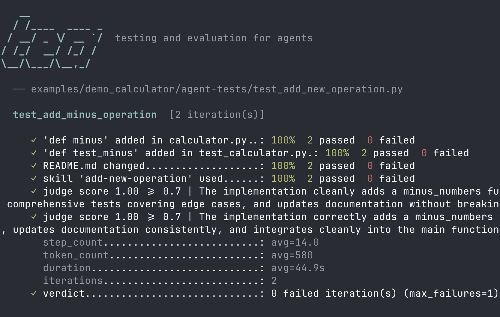

# tea - testing and evaluation for agents

Test and evaluation tool for agentic workflows. Run an agent against a task, assert what it did and measure how it performed.



## Getting started

### Requirements

- Python 3.11+
- Docker

### Install

```bash
pip install -e .
```

Or with [uv](https://docs.astral.sh/uv/):

```bash
uv sync
```

### Write a test

```python
from tea import (
    Agents,
    check_diff_added,
    check_file_changed,
    check_run_score,
    check_skill_used,
    iterations,
)


@iterations(2, max_failures=1)
def test_add_minus_operation():
    run = (
        Agents.ClaudeCode.prompt("Add 'minus' operation support to the calculator")
        .workdir("examples/demo_calculator")
        .run()
    )

    check_diff_added(run, "calculator.py", "def minus")
    check_diff_added(run, "test_calculator.py", "def test_minus")
    check_file_changed(run, "README.md")
    check_skill_used(run, "add-new-operation")
    check_run_score(
        run,
        (
            "Does this diff correctly implement a subtraction operation "
            "without breaking the existing structure? "
            "Score 1.0 if the implementation is clean and complete, "
            "0.5 if it works but has style issues, "
            "0.0 if it is broken or missing."
        ),
        min_score=0.7,
    )
```

Agent runs are nondeterministic, so `@iterations(n)` runs a test `n` times.
An iteration fails when any of its checks fail or the test raises. By default
a single failed iteration fails the test; pass `max_failures=k` to tolerate
flakiness — the test fails only if more than `k` iterations fail.

### Run tests

```bash
# Run all tests in a folder
tea examples/demo_calculator/agent-tests

# Run one file, repeated 5 times to measure pass rate
tea examples/demo_calculator/agent-tests/test_add_new_operation.py -n 5

# Run a single test function
tea examples/demo_calculator/agent-tests/test_add_new_operation.py::test_add_minus_operation
```

See [examples/demo_calculator/agent-tests](examples/demo_calculator/agent-tests) for runnable examples.

### Exit codes

`tea` is CI-friendly out of the box — run it as a pipeline step and the exit
code gates the build:

- `0` — all tests passed
- `1` — at least one test failed (or no tests were found)
- `130` — interrupted

## Checkers

- `check(label, condition)` — checks that `condition` is truthy and returns `bool`
- `check_skill_used(run, skill)` — checks that the agent used `skill` and returns `bool`
- `check_skill_not_used(run, skill)` — checks that the agent did not use `skill` and returns `bool`
- `check_tool_used(run, tool)` — checks that the agent called `tool` and returns `bool`
- `check_tool_not_used(run, tool)` — checks that the agent did not call `tool` and returns `bool`
- `check_file_changed(run, file)` — checks that `file` was created or modified and returns `bool`
- `check_file_not_changed(run, file)` — checks that `file` was left untouched and returns `bool`
- `check_diff_added(run, file, code)` — checks that `code` appears in `file`'s added lines and returns `bool`
- `check_diff_removed(run, file, code)` — checks that `code` appears in `file`'s removed lines and returns `bool`
- `check_output_score(output_to_evaluate, judge_prompt, min_score=0.5, judge=None)` — checks that the score assigned to the output using an LLM-as-a-Judge is higher than `min_score` and returns the score as `float`
- `check_run_score(run, judge_prompt, min_score=0.5, judge=None)` — checks that the score assigned to the agent run using an LLM-as-a-Judge is higher than `min_score` and returns the score as `float`

## Agents

### ClaudeCode

```python
Agents.ClaudeCode
    .prompt("Add 'minus' operation support to the calculator")
    .workdir("examples/demo_calculator")
    .run()
```

Setup `ANTHROPIC_API_KEY` (API-key auth, recommended). A long-term token
(`CLAUDE_CODE_OAUTH_TOKEN`, generated with `claude setup-token`) is also
supported.

### Codex

```python
Agents.Codex
    .prompt("Add 'minus' operation support to the calculator")
    .workdir("examples/demo_calculator")
    .run()
```

Setup `OPENAI_API_KEY` (API-key auth) and construct the harness with
`Agents.Codex.with_api_key()`. The default model is `gpt-5.2-codex`.

### Pi

Pi requires a `ModelConfig`:

```python
from tea.agent import ModelConfig

Agents.Pi.with_model(ModelConfig(
    model="ollama/qwen2.5-coder:1.5b",  # required
    api_key_env="MY_API_KEY",           # host env var forwarded into container
    base_url="http://localhost:11434",  # OpenAI-compatible endpoint
))
```

| Field | Required | Purpose |
|---|---|---|
| `model` | Yes | Model identifier |
| `api_key_env` | No | Name of a host env var to forward into the container as the API key |
| `base_url` | No | OpenAI-compatible endpoint for custom or local providers |

---

## Skills

Tea discovers project skills automatically from conventional, in-workdir paths
and copies them into the agent's native skill directory in the container.

| Agent | Default sources (searched in order) |
|---|---|
| ClaudeCode | `.claude/skills`, `.agents/skills` |
| Codex | `.codex/skills`, `.agents/skills` |
| Pi | `.pi/skills`, `.agents/skills` |

`.agents/skills` is the cross-agent convention — put a skill there and every
agent picks it up. Missing default paths are silently skipped. If the same
skill name appears in multiple sources, the earlier (agent-specific) source
wins.

Override the defaults with `skills_sources`:

```python
# One or more custom source paths (relative to the run's workdir).
Agents(skills_sources=["eval-fixtures/skills"])

# Per-run override.
Agents.ClaudeCode.prompt("...").workdir(".").skills_from(["custom/skills"]).run()

# Explicit opt-out: load no skills at all.
Agents(skills_sources=[])
```

Each skill is a directory containing a `SKILL.md` file with frontmatter:

```markdown
---
name: add-new-operation
description: How to add a new arithmetic operation to the calculator.
---

Step-by-step instructions live in the body of the file.
```

---

## Development

```bash
uv sync --group dev
uv run pre-commit install
```

Run checks manually:

```bash
uv run pre-commit run --all-files
uv run pytest tests/unit -q
```
